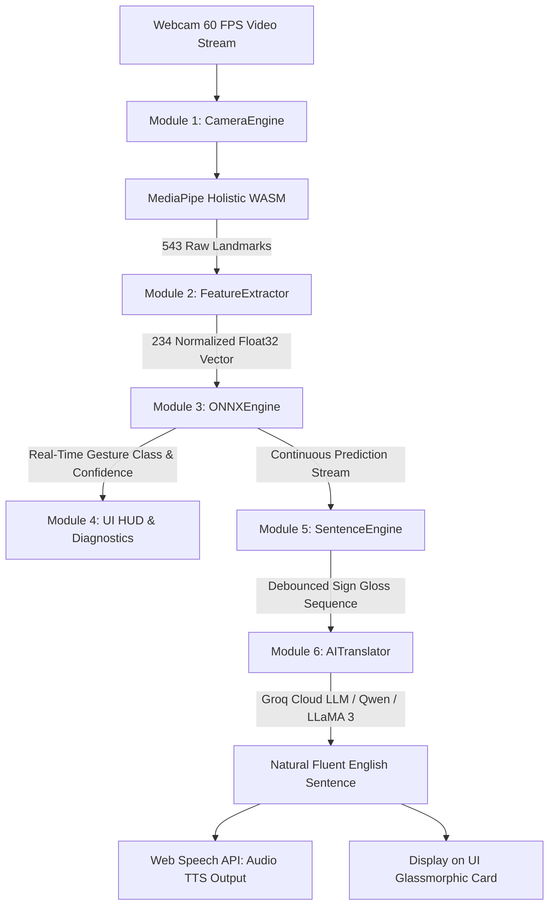
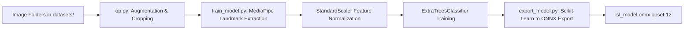

# Indian Sign Language (ISL) Real-Time Translator
### Comprehensive Technical Architecture, Machine Learning Pipeline & Implementation Guide

---

## 1. Executive Summary

The **Indian Sign Language (ISL) Real-Time Translator** is an end-to-end, zero-latency computer vision and natural language processing system. It translates physical Indian Sign Language gestures captured via a standard 2D webcam into fluent, grammatically correct spoken and written English in real time.

Traditional sign language translation systems frequently face severe bottlenecks:
1. **High Latency / Bandwidth Demands:** Streaming raw video frames or high-dimensional landmark tensors to a remote cloud server introduces high network latency (200ms–1500ms), making real-time two-way conversation impossible.
2. **Grammar & Gloss Disconnect:** Sign languages possess distinct syntaxes from spoken languages. Direct keyword recognition produces fragmented telegraphic glosses (e.g., `WORRY ALOT WATER`), which are jarring and hard for non-signers to comprehend.
3. **Heavy Hardware Dependencies:** Many state-of-the-art vision models require dedicated local GPUs or specialized depth cameras (e.g., Leap Motion, Kinect).

This project solves all three problems by combining:
- **Client-Side Edge Inference (Sub-15ms):** MediaPipe Holistic and ONNX Runtime Web run directly inside the browser using WebAssembly (WASM). No video or landmark data leaves the user's computer for classification.
- **Robust 234-Dimensional Invariant Feature Engineering:** A custom normalization engine guarantees invariance against camera distance, user physical proportions, and frame-centering offsets.
- **Contextual LLM Grammar Synthesis:** Recognized sign gloss sequences are autonomously accumulated, debounced, and dispatched to an ultra-fast Large Language Model (Groq / Qwen / LLaMA 3) that translates telegraphic signs into natural English with synchronized Text-to-Speech (TTS).

---

## 2. High-Level Architecture & End-to-End Data Flow

The entire processing lifecycle flows continuously through six decoupled modules:



### Complete Frame Lifecycle (Time: ~16ms / 60 FPS)
1. **Frame Capture (`camera.js`):** The browser requests a `640x480` video stream at up to 60 FPS via `navigator.mediaDevices.getUserMedia`.
2. **Landmark Extraction (`MediaPipe Holistic`):** MediaPipe processes the raw video frame and extracts 543 3D landmarks (33 pose landmarks, 468 face landmarks, and 21 landmarks per hand).
3. **Normalization & Vector Assembly (`feature_extractor.js`):** The raw landmarks are transformed into a standardized 234-element `Float32Array` that corrects for distance, camera perspective, and bodily scale.
4. **Local ONNX Classification (`onnx_engine.js`):** The 234-element vector is passed into the compiled `isl_model.onnx` running on ONNX Runtime WebAssembly. The model outputs class probabilities within ~3–8 milliseconds.
5. **Debouncing & Sequence Assembly (`sentence_engine.js`):** A candidate sign must be sustained consistently across consecutive frames (default: 8 frames) above a confidence threshold (35%) to be confirmed. Confirmed signs are pushed to the raw sentence register.
6. **AI Translation & Voice Playback (`ai_translator.js`):** When the user finishes signing (silence detection / pause debouncer), the accumulated glosses are sent to Groq's high-speed inference engine, translated to natural English, rendered on the dashboard, and read aloud using the Web Speech API.

---

## 3. Deep-Dive: Modular Architecture (Modules 1–6)

### Module 1: Camera & Video Pipeline (`camera.js`)
- **Purpose:** Manages hardware webcam access, handles media stream constraints, and maintains the render loop.
- **Key Capabilities:**
  - Requests optimal stream constraints: `{ width: 640, height: 480, frameRate: { ideal: 60, max: 60 } }`.
  - Dynamically synchronizes canvas dimensions to the incoming video resolution.
  - Computes a real-time rolling Frames Per Second (FPS) counter with smooth delta calculations.
  - Implements state callbacks (`requesting`, `active`, `error`) to drive UI overlay modals if camera permissions are blocked.

### Module 2: 234-Feature Normalization Engine (`feature_extractor.js`)
A raw landmark coordinate $(x, y, z)$ is vulnerable to how close a user sits to the camera, their height, shoulder width, and whether they stand in the center or off to one side. 

To achieve **complete translation-, scale-, and position-invariance**, the feature extractor translates 543 raw landmarks into a strictly normalized **234-dimensional vector**:

```
[ 99 Pose Features ] + [ 63 Left Hand ] + [ 63 Right Hand ] + [ 6 Hand-to-Nose ] + [ 3 Wrist-to-Wrist ] = 234 Features
```

#### Mathematical Formulation:
1. **Reference Landmarks:**
   - Left Shoulder: $\mathbf{P}_{11} = (x_{11}, y_{11}, z_{11})$
   - Right Shoulder: $\mathbf{P}_{12} = (x_{12}, y_{12}, z_{12})$
   - Shoulder Center (Origin): $\mathbf{C}_{\text{shoulder}} = \frac{\mathbf{P}_{11} + \mathbf{P}_{12}}{2}$
   - Shoulder Width (Scale Factor): $S_w = \|\mathbf{P}_{11} - \mathbf{P}_{12}\|_2 + 10^{-6}$
   - Nose Landmark: $\mathbf{P}_0 = (x_0, y_0, z_0)$

2. **Pose Normalization (33 points $\times$ 3 coords = 99 features):**
   $$\mathbf{v}_{\text{pose}}^{(i)} = \frac{\mathbf{P}_i - \mathbf{C}_{\text{shoulder}}}{S_w}, \quad \forall i \in [0, 32]$$

3. **Hand Normalization (21 points $\times$ 3 coords = 63 features per hand):**
   - Left hand wrist: $\mathbf{W}_{\text{LH}} = \mathbf{H}_{0}$
   - Metacarpophalangeal joint (base of middle finger): $\mathbf{M}_{9} = \mathbf{H}_{9}$
   - Hand Span (Scale Factor): $S_{\text{LH}} = \|\mathbf{M}_9 - \mathbf{W}_{\text{LH}}\|_2 + 10^{-6}$
   $$\mathbf{v}_{\text{hand}}^{(j)} = \frac{\mathbf{H}_j - \mathbf{W}_{\text{LH}}}{S_{\text{LH}}}, \quad \forall j \in [0, 20]$$

4. **Spatial Context: Hand-to-Nose Distances (6 features):**
   Preserves absolute signing height (e.g., whether a sign is performed near the forehead, chin, or chest):
   $$\mathbf{d}_{\text{nose-LH}} = \frac{\mathbf{W}_{\text{LH}} - \mathbf{P}_0}{S_w}, \quad \mathbf{d}_{\text{nose-RH}} = \frac{\mathbf{W}_{\text{RH}} - \mathbf{P}_0}{S_w}$$

5. **Two-Hand Coordination: Wrist-to-Wrist Vector (3 features):**
   Crucial for differentiating two-handed symmetric and asymmetric signs:
   $$\mathbf{d}_{\text{wrist-wrist}} = \frac{\mathbf{W}_{\text{LH}} - \mathbf{W}_{\text{RH}}}{S_w}$$

#### Landmark Persistence / Occlusion Buffer:
Fast motion can cause MediaPipe to drop a hand for a single frame. `feature_extractor.js` implements a hysteresis buffer: if a hand disappears for $\le 2$ consecutive frames, the engine reuses the last known coordinates rather than zeroing out features, eliminating flickering predictions.

#### Motion Trajectory Visualization:
Maintains an array of historical wrist coordinates over the previous 10 frames and renders glowing neon gradient trails on the canvas to illustrate the stroke and direction of signs.

---

### Module 3: In-Browser ONNX Runtime Web Engine (`onnx_engine.js`)
- **Technology:** `onnxruntime-web` executing via WebAssembly (WASM).
- **Execution Workflow:**
  1. Asynchronously fetches `isl_model.onnx` and `processed_data/label_map.json`.
  2. Spawns an in-browser inference session with single-threaded WASM (`ort.env.wasm.numThreads = 1`).
  3. Prepares a tensor of shape `[1, 234]` with Float32 values.
  4. Runs `session.run({ float_input: tensor })`.
  5. Computes a Softmax probability distribution over all classes:
     $$P(y = c \mid \mathbf{x}) = \frac{e^{z_c}}{\sum_{k} e^{z_k}}$$
  6. Returns the top predicted label, confidence percentage, and class index.
- **Failover Architecture:** If ONNX WebAssembly fails (e.g., in strict security environments), the engine falls back seamlessly to the Python server endpoint (`POST /api/predict`).

---

### Module 4: UI, Visualizer & Diagnostics HUD (`index.html`, `styles.css`)
- **Layout:** Responsive, high-contrast dark mode dual-column console built with CSS Grid and Flexbox.
- **Left Column:** Live interactive video feed with canvas overlays, tracking indicators, and dynamic error state screens.
- **Right Column:**
  - **Live Sign HUD:** Large real-time sign display with color-coded confidence levels (Green $\ge 60\%$, Amber $< 60\%$).
  - **Telemetry Grid:** Displays active model file, confidence percentage, detected pose landmarks (33/33), and active hands (L/R).
  - **Raw Sign Assembly Bar:** Interactive chip container displaying recognized sign sequence in chronological order.
  - **AI Natural Translation Card:** Gradient-accented translation card displaying natural English text, status shimmers, and audio playback buttons.
- **Accessibility & Feedback:**
  - Native Web Speech API integration (`window.speechSynthesis`) automatically speaks newly translated sentences.
  - One-click copy buttons for clipboard sharing.
  - Quick-access settings modal for API key and model selection.

---

### Module 5: Sentence Assembly & Debounce Engine (`sentence_engine.js`)
- **The Problem:** In continuous signing, the transition between one sign and another passes through intermediate positions (noise frames). Directly recording raw frames produces repeated duplicates and accidental words.
- **Solution (Temporal Debouncing):**
  - Requires a candidate sign to be predicted consecutively for a minimum threshold of frames (default: **8 consecutive frames** at 60 FPS $\approx$ 130ms).
  - Requires confidence to surpass the minimum threshold ($0.35$).
  - Suppresses immediate duplicate repetitions if the recognized sign matches the most recent word in the sentence.
  - Dispatches updates through `onSentenceChange(sentenceString, wordsArray)`.

---

### Module 6: Contextual Natural Language Translator (`ai_translator.js`)
- **The Problem:** Sign glosses follow sign language grammar (often topic-comment or object-subject-verb) and lack articles, auxiliary verbs, and prepositions.
  - *Raw Sign Glosses:* `WORRY ALOT WATER`
  - *Intended Meaning:* *"Don't worry, there is plenty of water."*
- **The Solution:** An autonomous natural language synthesis layer powered by Groq's low-latency LLMs.
- **Key Features:**
  - **Auto-Refinement on Signing Pause:** An idle timer detects when the user stops signing (1.5s debounce). It automatically invokes translation without requiring the user to touch the mouse or keyboard.
  - **Optimized System Prompt:** Instructs the LLM to output strictly the single natural English sentence with everyday conversational phrasing, omitting filler text or labels.
  - **Dual Network Routing:**
    - Primary: Dispatches through local Python proxy `POST /api/ai-translate`.
    - Secondary: Direct client-side fetch to `https://api.groq.com/openai/v1/chat/completions`.
  - **Models Supported:** `qwen/qwen3.8-27b`, `llama-3.3-70b-versatile`, `llama-3.1-8b-instant`, `openai/gpt-oss-20b`.

---

## 4. Machine Learning & Training Pipeline

The machine learning workflow converts image datasets into an optimized, web-ready ONNX model:



### 1. Dataset Preprocessing & Augmentation (`op.py`)
- Traverses image folders inside `datasets/`.
- Applies multi-crop boundary augmentations (e.g., 5% horizontal and vertical crops) using Pillow (`PIL.Image`).
- Multiplies training variety to ensure the classifier is resilient to off-center hands and varied camera angles.

### 2. Feature Extraction & Model Training (`train_model.py`)
- Automatically scans all subdirectory names in `datasets/` to construct the class catalog.
- Extracts the exact 234 normalized features from each training sample using MediaPipe Holistic Python.
- Prepares feature matrix `X_features.npy` ($N \times 234$) and label vector `y_labels.npy`.
- **Classification Model:** **ExtraTreesClassifier** (Extremely Randomized Trees)
  - Ensemble of randomized decision trees.
  - Provides superior resistance to overfitting on high-dimensional landmark coordinates compared to standard Random Forests or shallow neural networks.
  - Fast training and microsecond CPU inference times.
- Evaluated via **Stratified K-Fold Cross Validation** ensuring equal class representation across all folds.
- Serializes trained artifacts:
  - `processed_data/isl_model.pkl` (Trained classifier)
  - `processed_data/scaler.pkl` (StandardScaler parameters)
  - `processed_data/label_map.json` (Label to index mappings)

### 3. ONNX Pipeline Serialization (`export_model.py`)
- Bundles `StandardScaler` and `ExtraTreesClassifier` into a single `sklearn.pipeline.Pipeline`.
- Converts the entire pipeline to ONNX using `skl2onnx`:
  ```python
  initial_type = [('float_input', FloatTensorType([None, 234]))]
  options = {id(model): {'zipmap': False}}
  onx = convert_sklearn(pipe, initial_types=initial_type, target_opset=12, options=options)
  ```
- **Why `zipmap=False` is critical:** Default Scikit-Learn ONNX exports wrap class probabilities in a sequence of dictionaries (`Sequence<Map<Int64, Float>>`), which causes severe parsing overhead in JavaScript. Setting `zipmap: False` forces ONNX to output a clean, flat 2D Float32 Tensor (`[1, NumClasses]`), enabling instantaneous array access in the browser.

---

## 5. Local Server & Deployment Infrastructure

### Local Web Server (`server.py`)
- **Zero-Dependency Core:** Built using Python's standard library (`http.server`, `urllib.request`, `mimetypes`).
- **MIME Type Registration:** Browsers strictly require specific MIME types to execute WebAssembly and load binary model weights:
  - `.wasm` $\rightarrow$ `application/wasm`
  - `.onnx` $\rightarrow$ `application/octet-stream`
  - `.js`   $\rightarrow$ `application/javascript`
- **Fallback Endpoints:**
  - `POST /api/predict`: Receives a 234-feature vector from client, runs inference using Python `onnxruntime`, and returns class probabilities.
  - `POST /api/translate`: Proxies LLM requests to Groq with server-side `.env` key hiding.
  - `GET /api/health`: Validates model status, label count, and uptime.

### One-Click Launch Scripts
- **`run.bat`:**
  - Detects Python 3 (`python`), Python Launcher (`py`), or Node.js (`npx http-server`).
  - Launches `server.py` on port `8000`.
  - Spawns a background PowerShell process that automatically opens the browser at `http://localhost:8000`.
- **`run_desktop.bat`:**
  - Launches `live_testing.py` for direct desktop OpenCV live testing without opening a browser.

---

## 6. Directory Structure & File Map

```
d:\old_version_isl\
├── index.html               # Main frontend interface & client orchestration loop
├── styles.css               # Design system, glassmorphic UI, animations, HUD layout
├── camera.js                # Module 1: Webcam capture, stream constraints, FPS counter
├── feature_extractor.js     # Module 2: 234-feature normalization, hysteresis, motion trails
├── onnx_engine.js           # Module 3: ONNX Runtime Web client-side WASM inference engine
├── sentence_engine.js       # Module 5: Temporal debouncing & sign gloss accumulation
├── ai_translator.js         # Module 6: Groq LLM natural language translation & TTS engine
├── isl_model.onnx           # Compiled Scikit-Learn pipeline (Scaler + ExtraTrees) in ONNX format
├── server.py                # Local HTTP server with WASM MIME types & REST fallback API
├── train_model.py           # Training script: extracts features & trains ExtraTrees classifier
├── export_model.py          # Exporter: bundles Pipeline and serializes to isl_model.onnx
├── live_testing.py          # Standalone desktop OpenCV + MediaPipe real-time testing script
├── op.py                    # Dataset image augmentation & crop generator
├── onnx view.py             # Diagnostic script to inspect ONNX graph inputs/outputs
├── run.bat                  # One-click Windows runner for web application
├── run_desktop.bat          # One-click Windows runner for OpenCV desktop HUD
├── .env                     # Local environment file (stores GROQ_API_KEY)
├── .gitignore               # Version control rules
├── TECH_STACK.txt           # Condensed summary of all technologies used
├── PROJECT_EXPLANATION.md   # This comprehensive architectural documentation
└── processed_data/          # Generated model artifacts & training features
    ├── label_map.json       # Index-to-word sign mapping
    ├── isl_model.pkl        # Serialized ExtraTrees model
    ├── scaler.pkl           # Serialized StandardScaler
    ├── X_features.npy       # Extracted feature matrix (N x 234)
    └── y_labels.npy         # Target label indices (N)
```

---

## 7. Supported Vocabulary & Label Catalog

The system is trained and configured for the following 11 vocabulary classes:

| Class Index | Sign Keyword | Type | Typical Conversational Context |
|:---:|:---:|:---:|:---|
| `0` | **ABUSE** | Two-handed / Dynamic | Emergency, complaint, reporting distress |
| `1` | **AGREE** | One-handed / Static | Confirmation, acceptance, affirmative answer |
| `2` | **ALOT** | Two-handed / Spatial | Expressing high quantity, abundance, intensity |
| `3` | **WANT** | Two-handed / Torso | Expressing desire, requests, requirements |
| `4` | **WATER** | One-handed / Facial | Requesting drink, asking for water |
| `5` | **WEAR** | Two-handed / Body | Clothing, dressing, items worn on person |
| `6` | **WELCOME** | Two-handed / Social | Hospitality, greeting, polite welcome |
| `7` | **WHAT** | Two-handed / Question | Inquiry, asking for clarification |
| `8` | **WHERE** | One-handed / Question | Inquiry, directions, locations |
| `9` | **WHO** | One-handed / Facial | Inquiry, identifying individuals |
| `10` | **WORRY** | Two-handed / Chest | Emotion, concern, anxiety, reassurance |

---

## 8. Step-by-Step Guide: How to Run the Project

### Prerequisites
- **Operating System:** Windows 10 / 11
- **Python:** Python 3.8+ (with `numpy`, `opencv-python`, `mediapipe`, `scikit-learn`, `onnxruntime`, `skl2onnx`, `joblib`, `Pillow`)
- **Web Browser:** Modern browser with WebAssembly support (Chrome, Edge, Firefox, or Brave)
- **Webcam:** Any standard USB or built-in laptop webcam

### Running the Web Application (Recommended)
1. Double-click **`run.bat`** (or open PowerShell in the project directory and run `.\run.bat`).
2. The script will automatically start `server.py` on port `8000` and launch `http://localhost:8000` in your default browser.
3. Allow camera permissions when prompted.
4. Position yourself so your head, shoulders, and hands are visible.
5. Perform signs to watch the real-time classification, sentence assembly, and natural English AI translation!

### Running Native Desktop Mode (OpenCV)
1. Double-click **`run_desktop.bat`**.
2. An OpenCV window titled *"ISL Live Testing"* will open displaying the webcam feed with skeletal overlays, confidence metrics, and prediction telemetry rendered directly on the frame.
3. Press `Q` to quit.

### Training on New Signs / Extending the Model
1. Create a new folder under `datasets/<NEW_WORD>/` and add sample images.
2. Run data augmentation if needed:
   ```bash
   python op.py
   ```
3. Extract features and train the classifier:
   ```bash
   python train_model.py
   ```
4. Export the updated pipeline to ONNX:
   ```bash
   python export_model.py
   ```
5. Reload `http://localhost:8000` — the web app will automatically read the updated `isl_model.onnx` and `label_map.json`!

---

## 9. Key Technical Advantages & Innovations

1. **True Edge Computing (Privacy First):** Video frames and personal biometric landmarks never leave the client device during sign classification.
2. **Sub-15ms Latency:** WebAssembly-accelerated ONNX Runtime ensures instant feedback at a solid 60 FPS.
3. **Scale & Translation Invariance:** The custom 234-feature coordinate normalization guarantees reliable detection regardless of distance from the camera or user stature.
4. **Hysteresis Smoothing:** Eliminates prediction flutter caused by momentary tracking loss or rapid hand movement.
5. **Contextual Translation:** Bridges the fundamental communication gap between raw sign glosses and natural conversational English via high-speed LLM refinement.
